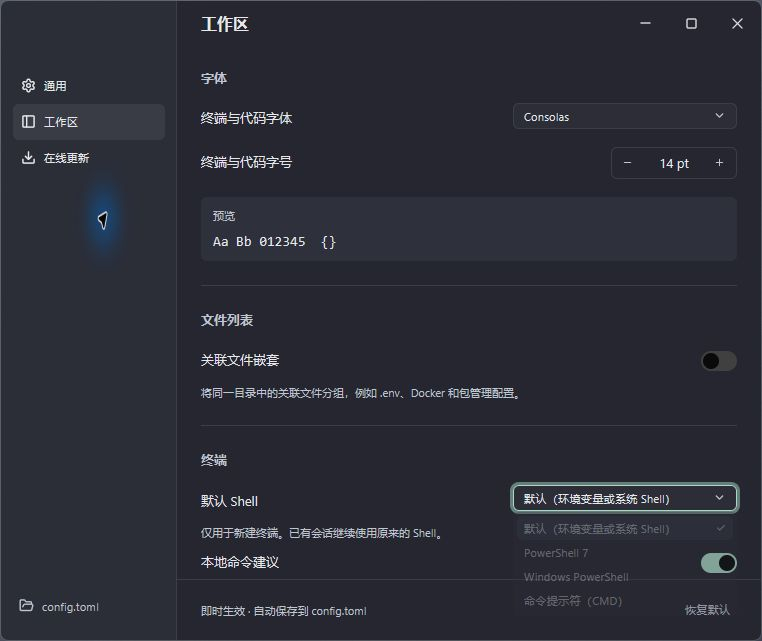

# Tervia 使用与开发指南

[English](guide.md) | 简体中文 · [返回产品介绍](../README.zh-CN.md)

这里保留完整的使用、配置、构建与发布说明。文中的命令均在仓库根目录执行。

## 运行

项目通过 `rust-toolchain.toml` 固定 Rust 1.99.0；首次运行会下载对应工具链与依赖。macOS 需要 macOS 15+ 和 Xcode：

```sh
./scripts/run.sh
```

脚本默认编译 release 构建，编译后也可以直接打开 `build/Tervia.app`；该构建支持在线更新。需要开发构建时运行 `cargo run --features native`。

Linux 需要 Vulkan 驱动以及 Fontconfig、ALSA、XKB、XCB、Wayland、PipeWire 等开发库；Ubuntu / Debian 安装命令见 `.github/workflows/native.yml`。运行 `cargo run --features native`，或在 Ubuntu / Debian 上安装 `dpkg-dev` 和 `rpm` 后，用 `./scripts/linux.sh` 生成 tar.gz、DEB 和 RPM。

Windows 使用 MSVC Rust 工具链和 Visual Studio C++ Build Tools，运行 `cargo run --features native`；安装 Inno Setup 6.3 或更新版本（`ISCC.exe` 位于 `PATH` 或默认安装目录）后，在 PowerShell 中执行 `./scripts/windows.ps1` 生成便携 ZIP 和安装 EXE。终端使用系统 ConPTY，默认打开 PowerShell 并保留 Profile。Linux 默认 Bash，macOS 默认 Zsh；设置了 `SHELL` 时优先使用该值。

Windows 可在设置 → 工作区 → 终端选择默认 Shell，或点击新建终端按钮旁的下拉箭头，为单次新建选择 Shell。支持已安装的 PowerShell 7、Windows PowerShell 和命令提示符（CMD）；“默认”沿用 `SHELL` 环境变量或平台默认值。配置文件对应 `[terminal] shell = "default"`，也可填写 `"pwsh"`、`"powershell"`、`"cmd"`。修改仅影响新建终端，已有会话和重连保留原来的 Shell。



Windows 应用 manifest 由 Tervia 统一提供，通过[固定版本 GPUI 的局部补丁](../vendor/gpui-pre/PATCH.md) 避免重复资源，同时保留 DPI、Common Controls v6、长路径和 UTF-8 设置。Windows CI 会检查链接后的 EXE 是否包含这些设置。

Git 接入在 macOS 上通过合成仓库测试、原生交互测试与深浅主题界面复查，实际验证了多仓库发现、折叠和滚动、区块暂存、提交、冲突编辑与继续合并。Git 核心通过 Windows GNU / Linux GNU 交叉编译检查；两个系统的图形界面仍需实机验证。CI 配置会在三个系统执行测试、构建及打包，尚未运行远程 CI。

## 自动发版

[发版脚本](../scripts/release.sh) 使用 POSIX shell、Git 和 Cargo，Windows 下使用 Git Bash。先修改 `Cargo.toml` 的 `package.version`，运行 `cargo check` 同步 `Cargo.lock` 并缓存依赖，提交所有改动后再发版。脚本读取已提交的版本，不会自动递增版本号。

```sh
git fetch --tags origin
sh scripts/release.sh --dry-run  # 预览 changelog，不修改文件或 Git 引用
sh scripts/release.sh --push     # 生成、提交、打标签并推送到 origin
```

不加参数时只创建本地版本，并打印推送命令。脚本根据最近可达的 `v*` 版本标签以来的非合并提交生成 `CHANGELOG.md`，首次发版使用完整历史。按 Conventional Commits 将提交归为新功能、修复、性能、文档、破坏性变更和其他变更，保留已有 changelog。随后创建 `chore(release): v<版本号>` 提交，再创建指向该提交的附注标签，标签说明包含本次 changelog。

脚本要求工作区干净、位于分支上、历史完整、lockfile 版本一致，且目标标签尚不存在。`--push` 会先同步 origin 标签，再原子推送当前分支和版本标签。Hook 或推送失败时保留生成的文件、提交与标签供检查；推送失败会打印重试命令。保留现有 Git hooks 与签名设置。

推送标签后触发[发布工作流](../.github/workflows/release.yml)，复用 macOS、Linux、Windows 的原生 CI 检查与 release 构建；三平台全部成功后，用附注标签中的 changelog 创建 GitHub Release，并上传 7 个带版本号的产物与 `SHA256SUMS`。发布前要求每种格式恰好一个、同平台架构一致，所有产物均写入校验和清单。手动推送轻量标签时仍使用 GitHub 自动生成的发布说明。`v0.2.0-beta.1` 等标签会标记为预发布，`Cargo.toml` 也需使用相同版本。GitHub 发布使用内置 `GITHUB_TOKEN`，macOS 发版还需下方的 Apple Secrets；已有 Release 不会被覆盖。

| 平台 | 发布格式 | 安装方式 |
| --- | --- | --- |
| macOS | `.zip`、`.dmg` | 打开 DMG，将 Tervia 拖到 Applications，或解压 ZIP。 |
| Linux | `.tar.gz`、`.deb`、`.rpm` | 解压压缩包，或使用系统包管理器安装 DEB/RPM。 |
| Windows x64 | `.zip`、`-setup.exe` | 解压便携 ZIP，或通过安装程序安装到当前用户并创建快捷方式。 |

本地生成 macOS 分发文件时，先执行 `./scripts/package.sh`，再执行 `bash scripts/macos.sh`；需要公证时，在两步之间运行 `sh scripts/sign.sh build/Tervia.app`。ZIP 和 DMG 使用同一份应用包，DMG 额外包含 Applications 快捷入口。Linux DEB/RPM 将程序、桌面入口、图标和第三方声明安装到 `/usr` 下，打包时自动检测动态库依赖。Windows 安装程序无需管理员权限，默认安装到 `%LOCALAPPDATA%\Programs\Tervia`，可选创建桌面快捷方式。复用已编译的 release 程序时，macOS 应用打包及 Linux 使用 `--no-build`，Windows 使用 `-NoBuild`。

### macOS 正式签名与公证

推送发版标签前，在仓库 **Settings → Secrets and variables → Actions** 配置：

| Secret | 内容 |
| --- | --- |
| `MACOS_CERTIFICATE` | 包含一个 **Developer ID Application** 证书及对应私钥的 `.p12`，转成 Base64。 |
| `MACOS_CERTIFICATE_PASSWORD` | 导出 `.p12` 时设置的密码。 |
| `APPLE_ID` | Apple 开发者账号邮箱。 |
| `APPLE_TEAM_ID` | 10 位开发者团队 ID。 |
| `APPLE_APP_SPECIFIC_PASSWORD` | 用于公证的 App 专用密码，不是 Apple 账号登录密码。 |

需要 Apple Developer Program 会员。从钥匙串访问中将证书与对应私钥一起导出，再执行 `base64 -i DeveloperID.p12 | pbcopy`，将结果粘贴到 Secret。证书必须属于 `APPLE_TEAM_ID` 指定团队；不接受 Apple Development 或 Mac App Store 分发证书。参考 [Apple Developer ID 说明](https://developer.apple.com/developer-id/)与[公证文档](https://developer.apple.com/documentation/security/customizing-the-notarization-workflow)。

[sign.sh](../scripts/sign.sh) 将证书导入临时钥匙串，启用 Hardened Runtime 和安全时间戳签名，提交 ZIP 给 Apple 公证，最多等待 30 分钟，只有状态为 `Accepted` 才附加票据并执行 Gatekeeper 检查，随后工作流生成最终 macOS ZIP 和 DMG。缺少凭据、签名无效、公证拒绝或超时、票据检查失败都会终止发版；公证失败时尽可能输出 Apple 诊断日志。成功或失败后都会清理临时证书、凭据与钥匙串，无需额外配置钥匙串密码 Secret。

目标为 `main` 的 PR 通过 [CI 工作流](../.github/workflows/ci.yml) 在 macOS、Linux、Windows 上运行格式检查、测试和 Clippy。推送到 `main` 后运行[原生构建](../.github/workflows/native.yml)，这些构建和本地开发构建使用 ad-hoc 签名。本地公证时，在装有 Xcode 的 Mac 上导出同名的五个环境变量，打包后执行 `sh scripts/sign.sh build/Tervia.app`。`sh scripts/sign.sh --check` 只检查必需值是否存在、团队 ID 格式是否正确，不连接 Apple 或验证证书有效性。

Linux 仍需安装上文所述运行库及兼容的系统 C 库；CI 使用 Ubuntu runner 构建，生成的二进制可能需要较新的发行版。每个产物对应其 CI runner 的架构，文件名会注明架构。在线更新继续使用原有命名的 ZIP/tar.gz。DEB/RPM 安装的程序通常由 root 持有，应使用包管理器升级。

## 开机自启

在 **设置 → 界面 → 启动** 中开启“开机自启”，登录电脑后会自动打开 Tervia，默认关闭。此设置直接读取和修改当前用户的系统启动项，不写入 `config.toml`；“恢复默认”不会修改它。操作失败时，设置页会显示原因并提供重试入口。

macOS 使用用户 LaunchAgent，Windows 使用当前用户的 Run 启动项，Linux 使用 XDG 自启动项。请先将应用安装到固定位置；移动应用后重新关闭、开启一次，以更新路径。

## 在线更新

默认启动时在后台检查 GitHub Releases 的最新稳定版本，运行期间**每 60 分钟自动检查一次**。在**设置 → 在线更新**中可开启或关闭自动检查、选择检查间隔、手动检查、查看更新说明，并确认**下载并安装**。发现新版本时，主窗口右上角显示带圆点的更新图标，点击即可确认下载并安装。下载时该图标变为圆形进度条；下载大小未知或正在校验、安装时显示旋转状态，安装完成后变为重启图标。失败会在发起更新的窗口弹出原因，并保留更新供重试；安装完成后点击**重启 Tervia**使新版本生效，也可稍后自行重启。

间隔从上一次检查结束时计算，手动检查和失败的检查也会重新计算下一次检查时间。检查失败后按设定间隔重试。设置中的修改立即生效；手动编辑 `config.toml` 的 `[updates]` 后重启生效。`interval_minutes` 支持 **5–10080 分钟（7 天）**，自定义分钟数会保留在设置菜单中。关闭自动检查后仍可手动检查；确认或安装期间暂停检查，安装完成后停止检查直到重启。自动检查仅提示新版本，下载和安装始终需要确认。

更新严格匹配操作系统与 CPU 架构，并使用检查时获取的 SHA-256 摘要校验下载包。macOS 整体替换已签名、公证的 `.app`，安装前检查签名和 Gatekeeper；Windows、Linux 替换发布包中的可执行文件。安装目录需要当前用户的写入权限，不会自动提权。校验或安装失败时保留原应用。

重启前必须保存所有项目和 worktree 中的编辑草稿，并等待保存、Git 等操作完成；确认重启会断开界面连接，后台终端进程继续运行；新版启动后会接回原会话。开发构建支持自动和手动检查，但不会安装更新。自动更新功能从包含此功能的发布版本开始可用，之前的版本需先手动升级。

## 可体验的交互

- 窄项目图标栏与展开项目列表；切换项目时保留各自的终端、Tab 和编辑草稿。
- 固定的终端 / Git / 文件 Tab，深色与浅色主题。在 Git 或文件页，可通过分支菜单旁的终端图标、视图菜单或 ⌘J / Ctrl+Shift+J 展开可调整高度的底部终端，共用正在运行的会话；新建或分屏时保留当前文档模块。
- 界面支持简体中文、繁体中文、英语、日语、韩语、法语、德语、西班牙语、葡萄牙语和俄语。默认使用系统首选语言，也可在设置中即时切换；偏好保存到可手动编辑的 TOML 配置文件。新增 Git 文案当前主要覆盖简体中文与英语，其他语言部分使用英语。
- 终端识别 Claude / Codex / Gemini / Grok / Hermes / OpenCode / OpenClaw，显示对应品牌图标与标签；退出 Agent 后恢复 Shell 标签。macOS / Linux 使用前台进程组，Windows 使用当前 Shell 的子进程树；Windows 中的后台 Agent 也可能影响标签。不会扫描终端对话内容来识别程序。
- 真实 PTY 终端：加载本机登录 / 交互 Shell 配置，新建、切换、关闭、分屏、滚动历史、键盘输入、UTF-8/输入法、ANSI/真彩色、全屏备用缓冲区。
- 鼠标拖选后 ⌘C 复制，⌘V 粘贴；支持括号粘贴、控制键与应用光标键。全屏程序启用鼠标报告时，按住 Shift 拖选文本。
- ⌘点击终端中的文件路径（Windows / Linux 为 Ctrl 点击），可打开文件并跳转到对应行列，支持 `src/main.rs:42:7`、引号内含空格的路径和当前项目内的绝对路径。相对路径以所选项目目录为基准；普通拖选和 TUI 鼠标操作仍可使用。
- 终端搜索支持 ⌘F（Windows / Linux 为 Ctrl+Shift+F）或工具栏搜索图标，搜索输出与滚动历史中的文字。小写查询忽略大小写，含大写的查询区分大小写；Enter / Shift+Enter 前后定位匹配，Esc 返回 Shell，最多显示 5,000 个匹配。后台终端发出铃声时，会话和所属项目显示请求关注标记；聚焦窗格后清除。
- 终端提示符与输入由 Shell 自己绘制，兼容已有提示符主题的基础协议；没有独立输入框。
- **本地命令建议**：在 Shell 输入至少两个字符后，光标旁显示最多 6 条前缀匹配的候选。例如输入 `git` 会显示 `git status`、`git stash`、`git commit`；继续输入 `git sta` 会筛选为匹配项。相同目录和 Shell 中成功执行过的历史命令优先，按频率、最近使用时间排序并去重，再补充常用 Git、Cargo、npm、pnpm 等命令。列表默认不选中候选，直接按 Enter 执行当前输入，不会改成候选命令。↑ / ↓ 主动选择后，Enter 只补上剩余字符，再按 Enter 执行；Tab 可直接补全首项，点击也只填入。Esc 收起列表后，方向键和 Tab 交给 Shell。继续编辑输入会取消候选选择。空输入和命令结束后不弹出建议。列表优先出现在输入行下方，空间不足时向上展开或减少可见行数，不改变终端行列数。搜索、输入法组合、查看滚动历史和全屏程序期间隐藏。Shell 历史导航、Tab 补全或光标移动后，暂停前缀补全到下一次空提示符，避免使用不准确的输入内容。
- **复用现有 Shell 历史**：Shell 启动配置加载后自动报告实际路径，支持 Zsh 的普通 / 扩展历史、Bash 的普通 / 时间戳历史、Fish 的历史文件和 PowerShell 的 PSReadLine 历史，包括自定义 `HISTFILE`、`fish_history` / `XDG_DATA_HOME` 和 `HistorySavePath`。从文件末尾最多读取 1 MiB，取最近最多 2,000 条可补全的单行记录；跳过空白开头、可识别的多行、未写完和无效编码的记录；Bash 无时间戳历史无法完全还原多行命令边界。候选顺序为当前目录的成功记录 → Shell 历史 → 常用命令，每组按频率和最近使用时间排序、跨组去重。原 Shell 历史只读且不复制进 `command-history.json`，不会伪造其目录或退出码；文件变化后下一次补全会重新读取。其他终端尚未落盘的历史需等待 Shell 自身保存。未配置历史文件、禁用历史或 Fish 私密模式时不导入。
- 在设置 → 界面 → 终端关闭“本地命令建议”，或设置 `[terminal] suggestions = false`。关闭后停止记录新命令。命令及目录、Shell、退出码等元数据仅保存在 `config.toml` 同目录的 `command-history.json`，不保存终端输出、不请求模型或网络服务；最多保留 2,000 条记录。空白开头或包含换行的命令不参与历史学习。关闭应用后可删除该文件清空历史；历史文件损坏时会保留原文件并显示错误。
- 命令边界通过临时 Shell 启动脚本采集，不修改用户的启动文件。Zsh、Bash 已通过真实 PTY 验证；Fish 使用原生事件，PowerShell 使用 PSReadLine。Bash 保留登录 Shell，通过首次提示符加载集成；启动配置完全替换 `PROMPT_COMMAND`，或单独占用 DEBUG trap 时会停用建议。其他 Shell 及未集成的 SSH / 嵌套 Shell 中保持常规终端行为。
- 真实 Git 管理：变更 / 历史 / 分支 / 远程 / Stash，原生行内 / 并排 Diff 和区块暂存。
- 文件页显示所选项目的目录树：按需读取、虚拟化长列表、展开 / 折叠，状态按项目保留。原生文件监控在后台暂停，回到前台立即刷新并继续自动同步目录和未修改的编辑内容；磁盘变化时保留未保存草稿。可从文件树、Git 或系统文件选择器打开文件；支持多个标签、语法高亮、查找、保存和右上角刷新。
- 文件树顶部可新建文件或文件夹；右键文件夹可在其中新建。文件与文件夹的右键菜单提供重命名、复制到、移动到、移到系统废纸篓、复制路径和在文件管理器中显示。复制或移动时输入相对于项目根目录的完整目标路径（包含名称）；父目录需已存在，同名目标不会被覆盖。Enter 确认、Esc 取消。重命名与移动保留打开文件的草稿，删除前需先保存或关闭受影响的未保存修改。已登记的项目/工作目录受到保护；符号链接的复制请使用系统文件管理器。
- 文件编辑器与 Git Diff 共用语言识别，支持 Rust、JavaScript / JSX、TypeScript / TSX、Python、Go、C / C++、C#、Java、Kotlin、Swift、HTML / CSS、JSON / YAML / TOML、Shell、SQL、Markdown、Vue、Dart、PowerShell、Fish、Dockerfile / Containerfile、INI、XML、JSON5、SCSS / Less、HCL / Terraform、Nix 等内置语法。可识别 Makefile、CMakeLists.txt、Cargo.lock、.env 系列、.editorconfig、.npmrc 等常见文件名；Markdown 代码块及网页、模板中的内嵌代码使用各自的语法高亮。
- 文件树单击使用临时预览标签，双击或编辑后固定；⌘P（Windows / Linux 文件页 Ctrl+P）快速查找文件，⌘⇧F / Ctrl+Shift+F 搜索项目文本。方向键选择、Enter 打开、Esc 返回目录树；搜索结果定位到对应行列。Markdown 支持阅读 / 源码切换，常见图片格式使用原生只读预览（沿用 4 MiB 读取上限）。搜索遵循忽略规则，跳过依赖目录、图片和二进制文件，并提示未完整或超限的结果。
- 文件标签支持关闭按钮、中键关闭、右键关闭其他 / 右侧 / 全部、拖动排序、Ctrl+Tab 切换和重新打开关闭的标签；关闭未保存文件前确认。
- 在文件源码或 Git Diff 中选中代码，点击**复制上下文**或按 ⌘⇧C / Ctrl+Shift+C，可复制项目相对路径、起止行号和代码。文件页使用当前草稿；Diff 使用画面中的源码，标明 `original` / `modified`，并分别输出不同版本和不连续的片段，支持拖选文字和通过行号选择整行。Markdown 需切换到源码视图；图片预览不提供代码上下文。
- 欢迎页提供“打开项目”和“直接使用终端”，并显示最近项目；克隆仓库作为次级入口保留。
- 带功能分类侧栏的独立原生设置窗口：选择已安装的常用等宽字体、调整终端 / 代码字号与界面字号、即时预览、恢复默认。

启动时恢复上次的项目、本地终端或欢迎页，同时恢复项目列表、顺序、当前工作目录和项目栏状态。首次使用时显示双入口欢迎页；上次的项目不可用时回到欢迎页并说明原因。模块、底部终端布局、终端标签数量与选中项、打开文件顺序和源码编辑位置也会恢复。未保存草稿连同原来的磁盘版本一并保留；干净文件在后台读取最新内容。退出应用只断开终端界面，后台会话继续运行；重开或应用更新后会接回原来的 Shell、运行中程序与 AI 对话，并恢复输出、终端模式和滚动位置。首次创建的项目终端在所属目录、本地终端在主目录启动。Git 使用本机 Git CLI，保存文件会写入磁盘。

## 代码跳转

在源码编辑器中按 **F12**，使用“文件 → 跳到定义”或编辑器右键菜单，也可以按住 **⌘**（Windows / Linux 为 **Ctrl**）悬停符号，出现下划线后点击。将 F12 用作系统功能键的键盘需要按 Fn+F12。

按住 ⌘（Windows / Linux 为 Ctrl）悬停符号，会显示下划线和紧凑的定义预览，包含文件、行号及一小段源码。预览使用目标文件的未保存草稿，不会自动打开标签；点击符号或预览里的“跳到定义”即可跳转。移开鼠标、松开修饰键、滚动或按 Escape 会收起预览；鼠标短暂经过符号时不会立即查询。

文件路径旁的后退 / 前进箭头可在成功的定义跳转间返回，包括同一文件内的位置；文件菜单和鼠标侧键提供相同操作。快捷键与 VS Code 一致：macOS 为 Ctrl+- / Ctrl+Shift+-，Windows 为 Alt+Left / Alt+Right，Linux 为 Ctrl+Alt+- / Ctrl+Shift+-。历史按项目隔离，保留草稿并恢复光标和滚动位置。后退后发生新的成功跳转会清空前进分支；失败或过期的跳转不会提交历史步骤。文件标签浏览和文本搜索匹配不加入这份定义跳转历史。

首次请求定义时，Tervia 优先复用本机可用的语言服务；缺少服务时，在后台自动下载或安装当前语言的服务，准备完成后继续跳转。状态栏显示准备、下载与安装状态，编辑区域保持原位。

| 源码语言 | 自动准备的语言服务 | 复用的运行环境 |
| --- | --- | --- |
| Rust | rust-analyzer 对应平台的独立二进制 | 项目现有 Rust 工具链 |
| JavaScript / JSX、TypeScript / TSX | TypeScript Language Server 与 TypeScript 6 | Node.js 22.22.2+ |
| Python | Pyright | Node.js 14+ |
| Go | 使用本机 Go 安装 gopls | Go 1.27+ |

此功能默认采用轻量策略：只准备当前请求的语言服务，应用启动和打开文件时不会预先下载；Node、Go 和项目依赖继续使用本机环境。缺少运行环境或版本不足时，状态栏提供官方下载入口与重试按钮，不会自动下载整套运行环境。

服务安装在用户数据目录的 `tervia/language-services` 中，无需管理员权限，不修改项目配置或全局工具。macOS 对应 `~/Library/Application Support/tervia/language-services`，Windows 使用 `%LOCALAPPDATA%`，Linux 使用 `$XDG_DATA_HOME`（默认 `~/.local/share`）。直接下载的二进制与 npm 包经固定版本的 SHA-256 / SHA-512 校验后才发布到共享缓存；后续项目和重启可直接复用。Go 安装时的私有编译缓存会随准备结束清理。网络失败或取消不会留下可用标记，再次请求即可重试。

语言服务按项目与语言族共用，闲置五分钟后退出，下一次跳转会重新启动，保留已下载的服务缓存；关闭项目或应用时停止服务。每次跳转同步已打开文件的内容，包括未保存修改。Rust 首次启动时等待工作区索引就绪。桌面启动的应用也会检查常见工具安装目录；使用自定义工具目录时，应让 Tervia 继承对应 `PATH`。

JavaScript/TypeScript 跳转只使用一个语义分析进程，复用项目已安装的类型声明，不会自动下载类型包。其所属进程默认使用较小的临时分配区（`--max-semi-space-size=8`），并保留 `NODE_OPTIONS` 中显式设置的值。这不会限制服务的总内存，语义分析所需内存仍取决于项目规模。

首版跳转到语言服务返回的第一个定义，并保留已打开目标文件的草稿。当前支持所选项目目录内的本地文件；目录外的依赖、标准库源码和虚拟文档会显示提示。此功能暂不启用代码补全、诊断或工作区编辑。

## 本地终端

项目栏顶部的“本地终端”可随时进入，不需要选择或创建项目。它使用用户主目录和现有 Shell 配置，支持独立标签、分屏、搜索和复制输出；不会扫描主目录或把主目录加入项目列表。切换项目保留正在运行的本地会话。

在欢迎页按 ⌘T / Ctrl+Shift+T 直接进入本地终端；在工作区按该快捷键为当前上下文新建终端。⌘⇧N / Ctrl+Shift+N 可从任意主界面新建本地终端。关闭最后一个本地标签会保留空白终端页，可再次新建；每个上下文最多保留 64 个标签。退出、重开和应用更新后可接回原会话；关闭标签会结束该会话。本地终端中的 `cd` 不会创建或切换项目；需要文件和 Git 界面时请明确打开项目。

## 终端会话恢复

终端由独立后台进程托管。退出、关闭主窗口或更新 Tervia 只断开界面，Shell、Agent 和其他运行中的程序继续执行；重新打开后连接同一会话，按原顺序恢复输出和尺寸变化，再接收实时内容。恢复期间暂停输入，历史提示音、剪贴板请求和命令记录不会再次触发。

关闭终端标签、经确认关闭项目或移除 worktree 会结束对应会话。已关闭的标签和终端进程已退出的普通会话都不会在重启后恢复；已完成的项目任务保留输出，供查看结果和主动重跑。全部结束或关闭后，终端页保持为空，直到主动新建标签。前台命令结束但 Shell 仍在运行的会话会保留。后台会话不可用时会明确报错，不会自动执行旧命令或用新 Shell 冒充恢复。电脑重启、注销或后台会话进程被终止后，原进程不能继续运行。

会话元数据、认证信息和原始输出保存在 `config.toml` 同目录的 `sessions/` 中，仅在本地使用。Unix 目录权限为 `0700`、数据文件为 `0600`，Windows 使用用户配置目录的访问权限。输出按流记录到磁盘，内存滚动历史仍限制为 10,000 行；长时间大量输出会增加磁盘占用和首次回放时间。清空终端会恢复为清空后的屏幕；关闭标签或项目会删除相应回放记录。`sessions/runtime/` 中保留正在运行的后台程序副本，避免应用更新覆盖它。macOS 会保留完整的已签名应用包，让主程序、Info.plist、资源签名和公证信息保持完整。

## 项目任务

点击项目导航栏的**运行任务**，或使用终端菜单、⌘⇧R（Windows / Linux 为 Ctrl+Shift+R），可搜索当前工作目录中的任务。↑ / ↓ 选择，Enter 运行，Esc 关闭；刷新按钮重新读取清单。切换到另一个工作目录或 worktree 后，任务发现使用该目录，不会递归扫描子项目。

- **package.json**：读取 `scripts`，通过 npm / pnpm / Yarn / Bun 的 `run` 执行。优先使用 `packageManager`；未声明时根据唯一的锁文件类型选择，均不存在则使用 npm。发现多种包管理器锁文件时显示提示，需在 `package.json` 明确声明 `packageManager`。
- **Cargo.toml**：提供 `cargo build`、`cargo check`、`cargo test`，以及显式二进制目标和默认 `src/main.rs` 的运行任务。运行二进制时带上其 `required-features`。
- **Makefile**：按 `GNUmakefile` → `makefile` → `Makefile` 的顺序选择配置，提取显式目标和 `.PHONY` 声明，支持多目标、续行和静态 recipe 前缀。宏、条件分支、动态目标和外部 include 不会被求值或展开，界面会提示发现不完整。
- **justfile**：支持大小写不敏感的 `justfile` / `.justfile` 文件名，读取公开 recipe 和可解析的别名；同时存在多个候选文件时提示冲突。无参数、有默认参数和零个起步的可变参数 recipe 可以直接运行；必填参数或高级参数属性暂不提供输入界面，会提示跳过。私有 recipe 和当前平台不可用的 recipe 不列出，import / mod 不展开。
- **Taskfile**：支持 version 3 的 `Taskfile.yml` / `.yaml`、小写文件名及 `.dist` 变体，按 Task 的文件优先级选择。读取字符串、命令列表、对象形式的任务和别名，支持有界 YAML 锚点与合并；内部任务和需要具体匹配值的动态任务名不列出。必填变量由 Task 在运行时根据配置和 Shell 环境校验，外部 includes 不展开。

发现任务只读取文件，不调用任务工具或执行脚本。每份清单最多读取 1 MiB，最多展示 256 个任务；目录文件名扫描最多检查 8,192 个条目，达到上限会提示。异常清单会提示原因，不影响其他来源的有效任务。运行命令会明确绑定所选配置文件；本机需已安装相应的 `make`、`just` 或 `task` 命令，并能通过所选 Shell 找到它们。

每次运行都新建独立终端，沿用当前默认 Shell，并在所选工作目录执行。上方显示命令、运行状态和最终退出结果，输出保留在终端中；任务结束或启动失败后可点击**重新运行**，创建新终端并保留上次结果。运行中不能通过该按钮重复启动同一轮任务。需要中断时，在任务终端按 Ctrl+C；关闭任务标签会结束该会话。

任务身份和已完成任务的输出也会恢复，重新打开 Tervia 只连接或回放原会话，不会自动重跑。关闭标签或项目会删除相应回放记录；重开已关闭的项目时，原任务标签恢复为普通 Shell，不会再次执行任务。支持 Bash、Zsh、Fish、sh、PowerShell 和 CMD；CMD 遇到不能安全传递的特殊任务名会报错，可切换到 PowerShell 后重试。首版不包含自定义任务配置、任务依赖或自动启动。

## Agent 状态与通知

在**设置 → 工作区 → Agent 状态与通知**中，分别为 Claude Code、Codex 点击**连接 / 修复**。Tervia 会向对应 CLI 的用户钩子配置添加自己的处理器，保留其他设置和钩子；**移除**只删除 Tervia 的处理器。自定义 `CLAUDE_CONFIG_DIR`、`CODEX_HOME` 时沿用相应目录。移动应用后重新连接以更新命令路径。

连接后新建 Tervia 终端并启动 Agent；已有终端需要重建才能获得会话标识。重启 CLI 以加载配置，Codex 还需要在 `/hooks` 中审核并信任新增钩子。组织策略或 CLI 设置禁用钩子时，精确状态不可用；未接入的 Agent 会明确显示“状态未接入”。其他 Agent 保留原来的进程识别和终端响铃提醒。

终端顶部显示就绪、处理中、等待授权、等待输入、本轮结束等状态。Claude Code 的 `StopFailure` 提供本轮失败状态，Codex 的 `Interrupt` 提供中断状态；可恢复的工具失败不会当作整轮失败。状态来自官方生命周期事件，不解析对话文本，也不根据输出停顿猜测完成。**本轮结束**表示 Agent 已结束本轮响应，不代表代码已经通过验收；其他钩子要求继续运行时，后续事件会更新状态。

新的授权/输入请求、响应结束和支持的失败事件会为未聚焦终端及所属项目增加提醒。聚焦终端后清除未读提示。**桌面通知**默认关闭，需在设置中主动开启；开启后在 Tervia 处于后台时发送，是否显示还受系统通知授权及勿扰设置影响；点击通知或“打开终端”返回原项目、工作目录和终端。标签重排或关闭后不会跳到其他会话。关闭开关保留状态与应用内提醒，重置界面设置也不会重新开启通知。

钩子仅在 Tervia 创建的终端中记录本地状态，不记录提示词、工具参数、对话正文或转录路径，也不会返回授权或阻止 Agent 的决定。重启 Tervia 恢复最近状态，不重发历史通知。完全退出 Tervia 后，后台终端仍可记录状态，但首版不会在界面退出期间投递桌面通知。

官方接口：[Claude Code hooks](https://code.claude.com/docs/en/hooks)、[Codex hooks](https://learn.chatgpt.com/docs/hooks)。需要支持这些生命周期事件的 CLI 版本。

## 项目管理

侧栏搜索按钮、文件菜单及 Cmd+Option+P（Windows/Linux 为 Ctrl+Alt+P）打开全局项目切换器。支持搜索名称、路径和模糊缩写，直接进入项目或已知工作目录/worktree。空查询优先显示收藏项目，再按最近访问排列；“返回上一个项目”恢复其上次使用的工作目录。

通过星标或右键菜单收藏项目。在收藏组或普通项目组内拖动可调整顺序，右键“上移/下移”提供相同操作。侧栏顺序在项目切换时保持稳定，并在重启后恢复。

“关闭项目”先将草稿、阅读位置和布局保存到恢复文件，再经具名确认结束该项目的终端会话；恢复保存失败时保留项目和终端。关闭前需等待 Git/文件操作完成。“最近关闭的项目”可从侧栏、文件菜单和欢迎页进入；重开后恢复编辑上下文，按需启动新的 Shell。关闭项目不会修改磁盘上的项目文件，也不会结束本地终端。关闭最后一个项目后，有本地会话时回到本地终端，否则回到欢迎页。

## 配置文件

首次启动自动生成带注释的 `config.toml`，可通过**设置侧栏左下角的 config.toml** 定位：

| 平台 | 默认位置 |
| --- | --- |
| macOS | `~/Library/Application Support/tervia/config.toml` |
| Linux | `$XDG_CONFIG_HOME/tervia/config.toml`，未设置时为 `~/.config/tervia/config.toml` |
| Windows | `%APPDATA%\tervia\config.toml` |

可通过环境变量 `TERVIA_CONFIG_FILE` 指定绝对文件路径。配置属于整个应用，不随项目目录变化。

工作恢复状态保存在同目录的 `workspace.json`，使用 v2 格式并兼容读取旧 v1 项目历史。普通变化每 300 ms 合并保存，切换项目和退出时立即刷新。目录暂时不可用时，未保存草稿仍保留在状态文件中；每个目录最多恢复 64 个终端标签和 512 个打开文件。无效、超限或被其他实例修改的状态会提示错误，保留原文件。

顶层按功能域划分大类：界面设置归入 `ui`，字体使用其下的 `fonts` 子类，文件列表分组使用 `files`，自动更新检查使用独立的 `updates` 类。今后终端、编辑器、Git、工作区等设置可以分别扩展为独立的顶层大类，避免所有配置平铺在一起。

```toml
[ui]
language = "system" # system、zh-CN、zh-TW、en、ja、ko、fr、de、es、pt、ru
theme = "dark"      # dark 或 light

[ui.fonts]
code_family = "Menlo" # 终端与编辑器共用的已安装字体
code_size = 14        # 11–24
ui_size = 13          # 11–16

[files]
nesting = false       # 在文件列表中分组显示关联文件

[updates]
auto_check = true
interval_minutes = 60 # 5–10080，默认 1 小时
```

代码字体默认值：macOS 为 Menlo、Windows 为 Consolas、Linux 为 DejaVu Sans Mono。未填写的配置项使用默认值；完整说明见[带注释的模板](../assets/config.toml)。

在**设置 → 界面 → 文件列表 → 关联文件嵌套**中开启同目录关联文件分组。内置规则参考 [antfu 的 File Nesting Config](https://github.com/antfu/vscode-file-nesting-config)，覆盖 `.env`、Docker、包管理、Rust、Python 和常见源码/测试文件。分组默认收起，点击箭头展开，点击文件名仍然打开文件；开关对所有项目即时生效，默认关闭。

设置窗口、主题切换和恢复默认都会即时生效并保存到同一文件。保存保留注释与未知配置项，使用原子替换，并保留 dotfiles 符号链接。手动编辑后重启 Tervia 生效；如果运行期间文件被修改，应用会停止保存并提示重启，避免覆盖外部编辑。

TOML 语法、配置值或读取出错时，使用默认设置启动并显示配置错误，不覆盖原文件。可在设置中查看错误详情并定位文件。保存失败时修改仍在本次运行中生效，设置窗口会提示错误；修复文件或权限后重启即可。

## Git 管理

- 打开真实工作目录、初始化仓库、克隆到新目录；可直接打开已有 linked worktree。打开父文件夹后保留该目录作为一个工作区根目录。侧栏按真实层级同时显示普通目录和仓库，逐层按需读取，并只渲染可见行。箭头展开目录，名称切换到对应的实际工作目录；Git 图标和分支仅作为仓库目录的附加信息。折叠保留当前目录，并在父目录下显示其相对路径。侧栏收起为图标时，弹出同样的目录树，支持方向键、Enter 和 Esc。各目录独立保留终端、草稿和当前模块，历史记住当前目录及根目录折叠状态；手动展开没有深度限制，只有自动 Git 识别限制为 3 层；支持 `.git` 目录和 `.git` 文件。
- 历史、变更文件、分支、侧栏、Stash 与原始文本详情按可见行虚拟渲染。文件夹与变更 / 仓库 / 分支 / 标签分组可以折叠，状态按项目保留。
- 保留整个窗口的连续灰蓝渐变；折叠栏整行 hover，计数右侧有内间距。
子仓库扫描在后台进行，最多检查所选文件夹下面 3 层子目录、8,192 个目录和 128 个 Git 工作目录，时间预算为 3 秒。未完整扫描时会说明触发的是时间、深度、目录数量、Git 工作目录数量上限，还是目录无法读取；同一仓库的 worktree 仍归为一个仓库。扫描跳过 `.git` 元数据、node_modules、target、build、.venv 与 .cache，不跟随子目录符号链接；遗漏的仓库可以直接打开或重新扫描。

- 分别显示 index / worktree 状态，同一文件可以同时出现在已暂存和未暂存组；支持新增、修改、删除、重命名与冲突。
- 未暂存分组支持撤销单个文件或全部修改，确认后还原到暂存区内容，保留已暂存修改。未跟踪文件支持单个或整组移到系统废纸篓；忽略文件和编辑器未保存的草稿会保留。冲突、子模块和嵌套仓库需单独处理，移到废纸篓失败时不会改为永久删除。
- 原生虚拟化 Diff、语法高亮、行内 / 并排、按文件或区块暂存和取消暂存。区块应用前检查快照，保留 CRLF 与行尾空白。
- Git 提交区默认折叠，保留提交草稿与暂存数量；可展开 Diff 为专注视图，按文件或改动区块前后导航。查看完整文件后可返回原 Diff；近期文件的阅读位置在改动内容不变时保留。
- 可将文件标为“已查看”，标记绑定文件、暂存区和 HEAD 的版本；刷新发现内容变化时取消标记，即使 Git 状态字母相同也能识别。设置检查点会捕获当前磁盘内容（包含 Git 未忽略的未跟踪文件），保留实际暂存区；比较检查点查看下一轮新增改动，支持手动刷新并返回工作区。比较视图不提供暂存操作，检查点和审查标记属于当前运行。
- 多行提交说明、普通提交与 amend；失败保留说明，提交只消费 index。保留本机 hooks 与签名行为。
- 提交图展示父子关系、分叉与合并，并显示分支 / 标签。支持作者 / 说明 / ref / hash 筛选，断线表示被筛选隐藏的提交。历史最多加载 2000 条，滚动和分页时保留轨道；父提交链接可查看尚未加载到列表中的提交。详情提供文件导航，合并提交显示相对第一父提交的改动，完整提交信息可展开查看。
- 创建 / 切换 / 重命名 / 删除本地分支、跟踪远程分支、创建 / 删除标签。
- Worktree 归属同一项目，在 Git 侧栏按折叠列表切换，各目录分别保留终端、标签和草稿。主目录显示独立标记，长分支名不会遮住它。右键 Worktree 可打开目录、复制路径、在文件管理器中显示，以及锁定 / 解锁；“移除”单独放在菜单底部，确认框会显示完整目标路径。主目录不提供锁定操作，当前目录的“打开”和受保护目录的“移除”会禁用；管理页保留完整操作入口。支持从新分支、已有分支或游离 HEAD 创建，打开、锁定 / 解锁及清理失效登记。移除保留分支，检查 Git 改动和未保存编辑内容，不提供强制删除。
- 添加 / 删除 remote、更新 URL、fetch、快进 pull、merge / rebase pull、push 和首次设置 upstream。
- Stash 保存（包含未跟踪文件）、预览、apply、pop、drop；操作绑定对象 ID，删除在 Git 引用锁内校验目标。当前支持 files 引用存储；其他存储格式会保留条目并提示终端处理。
- merge / rebase 状态、冲突三阶段内容查看、结果编辑、标记解决、继续和中止；删除文件也可作为解决结果。
- Git 页每 3 秒在后台刷新，切入页面或操作完成时刷新；后台结果保留项目归属并拒绝过期 Diff / 文件读取。

使用现有 Git 配置、SSH、credential helper 和签名程序；需要交互认证时可在终端完成。编辑器限 UTF-8 文本与 4 MiB 文件；非 UTF-8 Diff 给出提示，整文件暂存仍保留原始字节。Git 输出上限 8 MiB。交互式 rebase、PR / Issue / CI 集成属于后续工作。

创建终端时会移除启动器继承的 `NO_COLOR`，并声明 `xterm-256color` / `truecolor` 能力，避免从无色命令环境启动应用时让 TUI 自动关闭颜色。用户的 Shell 配置或单条命令仍可显式设置 `NO_COLOR`。

当前终端主要实现标准 xterm/VT 交互；图片协议和完整 Kitty 键盘协议尚未实现。兼容性需要按具体插件和程序验证。

## 快捷键

顶部系统菜单栏提供“文件 / 视图 / 终端”：打开文件夹或文件、快速查找与项目搜索、保存与标签管理、切换模块与主题，以及新建、分屏、清空和复制终端输出。菜单随界面语言即时切换，不适用的操作自动禁用；清空和复制输出作用于当前获得焦点的终端窗格。

| macOS | Windows / Linux | 操作 |
| --- | --- | --- |
| ⌘O | Ctrl+Shift+O | 打开文件夹 |
| ⌘B | Ctrl+Shift+B | 展开 / 收起项目栏 |
| ⌘⌥P | Ctrl+Alt+P | 搜索项目与工作目录 |
| ⌘J | Ctrl+Shift+J | 在 Git / 文件页展开或收起底部终端 |
| 终端内 ⌘F | 终端内 Ctrl+Shift+F | 搜索终端输出和滚动历史 |
| ⌘1 / ⌘2 / ⌘3 | Ctrl+1 / Ctrl+2 / Ctrl+3 | 终端 / Git / 文件 |
| ⌘T | Ctrl+Shift+T | 在当前上下文新建终端；欢迎页直接使用终端 |
| ⌘⇧N | Ctrl+Shift+N | 新建本地终端 |
| ⌘S | Ctrl+S | 保存当前文件到磁盘 |
| ⌘W | Ctrl+W | 关闭当前文件标签 |
| ⌘W | Ctrl+Shift+W | 关闭当前终端标签（项目保留最后一个终端） |
| Ctrl+Tab / Ctrl+Shift+Tab | Ctrl+Tab / Ctrl+Shift+Tab | 下一个 / 上一个文件标签 |
| ⌘Shift+T | Ctrl+Shift+T | 重新打开关闭的文件标签 |
| ⌘F | Ctrl+F | 编辑器内查找 |
| F12 / ⌘点击 | F12 / Ctrl 点击 | 跳到编辑器中符号的定义 |
| ⌘⇧P | Ctrl+Shift+P | 快捷操作 |
| ⌘, | Ctrl+, | 打开独立设置窗口 |
| ⌘C / ⌘V | Ctrl+Shift+C / Ctrl+Shift+V | 复制终端选区 / 粘贴到终端 |
| ⌘⇧C | Ctrl+Shift+C | 在文件源码 / Git Diff 中复制带路径和行号的选区上下文 |
| ⌘K | Ctrl+Shift+K | 清空获得焦点的终端屏幕与滚动历史，并请求程序重绘 |
| Ctrl+K | Ctrl+K | 发送给 Shell / TUI，保留程序原有快捷键 |
| ⌘⌫ | Ctrl+U（Bash/Zsh）或 Ctrl+Home（PowerShell） | 调用 Shell 的删行操作；光标在行尾时清空当前命令 |
| ⌘← / ⌘→ | Home / End | 通过 Shell 的编辑键移动到行首 / 行尾 |
| ⌥⌫ | Ctrl+Backspace | 删除光标前的一个词，具体边界由 Shell 决定 |
| — | Ctrl+← / Ctrl+→ / Ctrl+Delete | 发送带 Control 修饰的方向键 / Delete，交给 Shell 或 TUI 处理 |
| ⇧PageUp / ⇧PageDown | Shift+PageUp / Shift+PageDown | 终端历史翻页 |
| Esc | Esc | 终端焦点下发送给程序；其他区域优先关闭弹层，再关闭窗口 |

## 验证

```sh
python3 -B -m unittest discover -s tests -p 'test_*.py'
cargo test --no-default-features
cargo test --features native
cargo test --features ui-tests
cargo fmt --all -- --check
cargo clippy --features native --all-targets -- -D warnings
cargo build --features native
```

## 结构

- `src/config.rs`、`assets/config.toml`：用户配置、校验和保留注释的持久化。
- `src/state.rs`：独立于 GPUI 的真实项目、终端与编辑草稿状态。
- `src/terminal.rs`、`src/pty.rs`：终端解析、按键编码、选区和真实 PTY 生命周期。
- `src/locale.rs`、`assets/locales.json`：系统语言匹配和界面文案。
- `src/agent.rs`：前台 Agent 的纯路径识别规则。
- `src/platform.rs`、`src/process.rs`：平台字体、Shell、快捷键和后台进程查询。
- `src/ui/console.rs`：GPUI 原生终端渲染、输入法与交互。
- `src/git/`：Git 命令与输出、状态解析、Diff、仓库快照和写操作。
- `src/files/`：磁盘读写、范围检查和异步读取版本保护。
- `src/ui/`：应用外壳、终端、Git、文件视图和视觉样式。
- `tests/git.rs`：只使用合成临时仓库与本地 bare remote 的 Git 集成测试。
- `tests/reads.rs`：异步重新加载与草稿保护测试。
- `tests/workspace.rs`：项目隔离与终端 / 工作区生命周期测试。
- `PRODUCT.md`、`DESIGN.md`：已确认的产品边界与界面设计。
